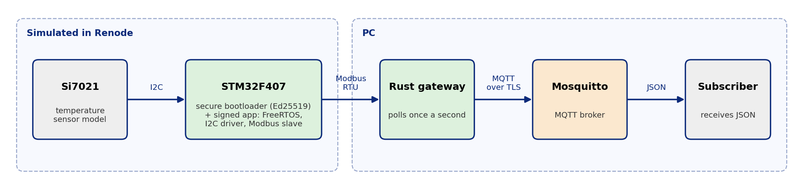

# stm32-modbus-mqtt-node

Embedded C firmware for an STM32F407 (Cortex-M4) running FreeRTOS, simulated in [Renode](https://renode.io).
No hardware needed. A Rust gateway reads the node over Modbus RTU and publishes the values as JSON, optionally to an MQTT broker over TLS.

The diagram is generated by `docs/make_diagram.py`.

## What is in here
- `bootloader/`: secure-boot bootloader (SHA-256 written here, Ed25519 verification via [TweetNaCl](https://tweetnacl.cr.yp.to/), public domain, in `third_party/tweetnacl/`)
- `tools/`: key generation and the image signer (`sign_image.py`); `include/image_header.h` defines the signed image format
- `src/startup.c`, `ld/app.ld`: own start-up code, vector table and linker script for the application (no vendor library)
- `src/i2c.c`: own polling I2C1 driver (register level, mutex-protected, timeouts) reading a Si7021 temperature sensor
- `src/uart.c`: own USART1 driver for the debug log; `src/modbus_port.c`: USART2 receive interrupt and Modbus task
- `src/modbus_core.c`: Modbus RTU slave logic (CRC16, function 0x03, exception replies), plain C, tested on the host
- `src/main.c`: FreeRTOS tasks (sampler, logger, heartbeat) and the queue between them
- `gateway/`: Rust Modbus master with JSON output and MQTT publishing (TLS with a custom CA)
- `tests/`: host unit tests, Renode end-to-end tests, MQTT/TLS test
- `sim/`: Renode scripts

## Register map (holding registers, read-only, slave address 1)
| Register | Content |
|---|---|
| 0 | temperature in 0.1 °C (signed) |
| 1 | sample counter |
| 2 | uptime in seconds |
| 3 | I2C error count |

## Build and run
Needs `gcc-arm-none-eabi`, `cmake`, `openssl`, Python 3, Renode 1.17, a Rust toolchain, and FreeRTOS-Kernel in `third_party/`. The first CMake run creates a signing key pair in `keys/` (never commit `keys/private.pem`).

    git clone --depth 1 --branch V11.3.3 https://github.com/FreeRTOS/FreeRTOS-Kernel.git third_party/FreeRTOS-Kernel
    ./run_sim.sh        # build, run in Renode for 5 seconds, print the debug log (USART1)
    ./run_sim.sh 10     # same, 10 seconds
    ./run_gui.sh        # open Renode's GUI with a live terminal window for the debug log

## Tests
| Test | Command | Status |
|---|---|---|
| Modbus core and SHA-256 unit tests (host) | `make -C tests` | passing |
| Gateway unit tests | `cargo test --manifest-path gateway/Cargo.toml` | passing |
| Firmware + Modbus over the simulated UART | `python3 tests/sim_modbus_test.py` | passing (local) |
| Firmware + gateway end to end | `python3 tests/sim_gateway_test.py` | passing (local) |
| Secure boot (7 scenarios, below) | `python3 tests/sim_secure_boot_test.py` | passing (local) |
| Gateway to Mosquitto over TLS | `tests/mqtt_tls_test.sh` | passing (local, needs Mosquitto + mosquitto-clients) |

CI (`.github/workflows/ci.yml`) builds the firmware and runs the host and gateway unit tests. The Renode tests run locally only, and the workflow itself has not run yet.

## Signed firmware and secure boot
Flash map: bootloader at `0x08000000` (64 KiB), image header at `0x08010000`, application at `0x08010100`.
The header holds a magic number, the firmware version, the image size and an Ed25519 signature over
SHA-256(version, size, application bytes). The bootloader recomputes the hash, checks the signature against the
public key built into it, checks the version, and only then jumps to the application. Otherwise it prints why it
refused and stops.

The secure-boot test boots seven images and checks the bootloader's log:

| Image | Expected result |
|---|---|
| valid, version 1 | boots |
| one bit flipped in the application | refused: bad signature |
| version field edited, not re-signed | refused: bad signature |
| signed with a different key | refused: bad signature |
| signed correctly, version 0 | refused: version too old |
| blank flash | refused: no image |
| valid, version 2 | boots (the "update") |

Sign and build a different version: `cmake -S . -B build -DAPP_VERSION=2 && cmake --build build`.

## Limits
- Everything runs in simulation. Nothing has been tested on real hardware.
- The sensor is Renode's Si7021 model, fixed at 22.5 °C by `sim/serve.resc`. The I2C driver works against that model; it has not been tried on a real sensor or bus.
- The I2C driver polls (no interrupts or DMA) and handles only the read pattern the Si7021 needs.
- The Modbus frame end is detected with a fixed 5 ms gap, not the exact 3.5-character timing.
- Renode's simulated clock does not match the 16 MHz the code assumes, so uptime values run fast.
- The "update" is a new signed image loaded into the simulated flash by the test script. There is no over-the-air transfer and the bootloader does not write flash.
- Anti-rollback is a build-time minimum version in the bootloader, not a counter kept in protected flash, so an attacker with flash access could still downgrade a real device.
- The signing key is a local test key. Production keys would live in an HSM or a signing service.
- The bootloader itself is not protected: nothing locks the flash against rewriting it.

## Next
- [x] I2C driver with a simulated sensor
- [x] Run the MQTT/TLS test
- [x] Signed firmware images and secure boot (simulated)
- [ ] Over-the-air transfer and flash writing
- [ ] Persistent anti-rollback counter
